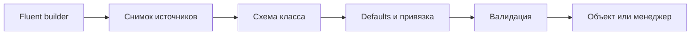

# Архитектура

[Русский](ARCHITECTURE.md) · [English](en/ARCHITECTURE.md) · [Deutsch](de/ARCHITECTURE.md)

[Оглавление](README.md)

`Settings.Load<T>` создаёт builder, читает источники, строит схему и загружает один тип. `SettingsManager.Create` читает источники один раз и загружает зарегистрированные группы из общего снимка. Это один последовательный проход по источникам, а не атомарная транзакция между ОС и файлами.

Схема строится reflection: публичные свойства, атрибуты, вложенные типы. Циклы, неподдерживаемые типы и коллизии ключей отклоняются до создания объекта. Затем вызывается конструктор, сохраняются defaults, применяются строки и выполняется валидация. Пользовательские исключения не прикрепляются к диагностике.

Менеджер после создания хранит закрытый словарь объектов и не меняет его. `Get<T>` не читает env повторно и возвращает тот же объект. С `init`-свойствами безопасны обычные параллельные чтения. Если модель имеет `set`, потокобезопасность её изменений обеспечивает приложение. Для нового снимка создайте новый менеджер и явно передайте его потребителям. Старые ссылки остаются прежними.

Файловые handles закрываются при чтении. Менеджер не владеет ресурсами и не требует Dispose. Global singleton, фоновые задачи и внешние runtime-пакеты отсутствуют.

| Файл | Ответственность |
| --- | --- |
| `Settings.cs` | Независимая загрузка |
| `SettingsManager.cs` | Регистрации, загрузка всех групп, получение объектов |
| `SettingsConfiguration.cs` | Fluent API, источники, overrides |
| `Attributes.cs` | Имена, префиксы, чувствительность |
| `SettingsException.cs` | Ошибки без значений |
| `Internal/SettingsBinder.cs` | Схема, привязка и валидация |
| `Internal/ValueConversion.cs` | Явный список типов, invariant parsing |
| `Internal/DotEnvReader.cs` | Ограниченный dotenv parser |
| `Internal/KeyNames.cs` | Имена ключей и внутренние значения |

Reflection и DataAnnotations означают, что совместимость с trimming/Native AOT не заявлена. Source generator, произвольные converters и внешний provider API не включены в 1.0.
