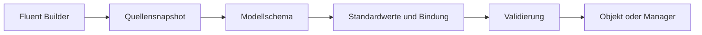

# Architektur

[Русский](../ARCHITECTURE.md) · [English](../en/ARCHITECTURE.md) · [Deutsch](../de/ARCHITECTURE.md)

[Inhalt](README.md)

`Settings.Load<T>` erstellt einen Builder, liest Quellen, baut ein Schema und lädt einen Typ. `SettingsManager.Create` liest Quellen einmal und lädt alle Gruppen aus diesem Snapshot. Dies ist ein sequenzieller Durchlauf, keine atomare Transaktion über Betriebssystem und Dateien.

Reflection baut das Schema aus öffentlichen Eigenschaften, Attributen und verschachtelten Typen. Zyklen, nicht unterstützte Typen und Schlüsselkollisionen werden vor der Konstruktion abgelehnt. Danach liefert der Konstruktor Standardwerte, Zeichenfolgen werden angewendet und validiert. Benutzerdefinierte Ausnahmen werden Diagnosen nicht angehängt.

Der fertige Manager hält ein privates, unverändertes Wörterbuch. `Get<T>` liest die Umgebung nicht erneut und klont keine Objekte. Mit `init`-Eigenschaften sind parallele Lesezugriffe sicher. Bei `set` verantwortet die Anwendung sichere Änderungen. Für einen neuen Snapshot einen neuen Manager erstellen und explizit an Verbraucher weitergeben. Bestehende Referenzen behalten ihre bisherigen Werte.

Dateihandles werden beim Lesen geschlossen. Manager besitzen keine Ressourcen und benötigen kein Dispose. Keine globalen Singletons, Hintergrundarbeit oder externen Laufzeitpakete.

| Datei | Verantwortung |
| --- | --- |
| `Settings.cs` | Unabhängiges Laden |
| `SettingsManager.cs` | Registrierung, sofortiges Laden, Zugriff |
| `SettingsConfiguration.cs` | Fluent API, Quellen, Overrides |
| `Attributes.cs` | Namen, Präfixe, Sensitivität |
| `SettingsException.cs` | Diagnosen ohne Werte |
| `Internal/SettingsBinder.cs` | Schema, Bindung, Validierung |
| `Internal/ValueConversion.cs` | Explizite Typen und kulturunabhängige Konvertierung |
| `Internal/DotEnvReader.cs` | Begrenzte dotenv-Grammatik |
| `Internal/KeyNames.cs` | Schlüsselnamen und interne Rohwerte |

Aufgrund von Reflection und DataAnnotations wird keine Kompatibilität mit Trimming/Native AOT zugesichert. Source Generator, beliebige Converter und eine externe Provider-API gehören nicht zu 1.0.
