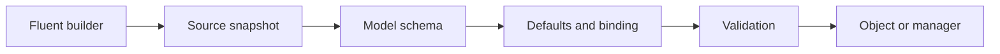

# Architecture

[Русский](../ARCHITECTURE.md) · [English](../en/ARCHITECTURE.md) · [Deutsch](../de/ARCHITECTURE.md)

[Contents](README.md)

`Settings.Load<T>` creates a builder, reads sources, builds a schema and loads one type. `SettingsManager.Create` reads sources once and loads registered groups from that snapshot. Reading is a sequential pass, not an atomic transaction spanning OS env and files.

Reflection builds the schema from public properties, attributes and nested types. Cycles, unsupported types and key collisions are rejected before construction. Next, the constructor supplies defaults, strings are applied and validation runs. User exceptions are not attached to diagnostics.

A created manager holds a private dictionary that never changes. `Get<T>` neither rereads env nor clones the object. Ordinary concurrent reads are safe with `init` properties. If models use `set`, the application controls mutation safety. For a new snapshot, create another manager and explicitly pass it to consumers. Existing references keep their previous values.

File handles close during reading. Managers own no resources and need no Dispose. There is no global singleton, background work or external runtime package.

| File | Responsibility |
| --- | --- |
| `Settings.cs` | Independent loading |
| `SettingsManager.cs` | Registration, eager group loading, retrieval |
| `SettingsConfiguration.cs` | Fluent API, sources, overrides |
| `Attributes.cs` | Names, prefixes, sensitivity |
| `SettingsException.cs` | Value-free diagnostics |
| `Internal/SettingsBinder.cs` | Schema, binding and validation |
| `Internal/ValueConversion.cs` | Explicit supported types and invariant parsing |
| `Internal/DotEnvReader.cs` | Bounded dotenv grammar |
| `Internal/KeyNames.cs` | Key naming and internal raw values |

Reflection and DataAnnotations mean trimming/Native AOT compatibility is not claimed. Source generators, arbitrary converters and an external provider API are outside 1.0.
